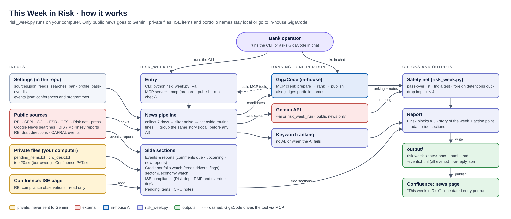
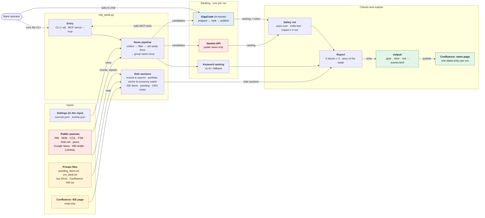

# This Week in Risk

Collects the week's most impactful developments in **Indian banking risk management**, as they
matter to **a foreign bank operating in India**, and arranges them in six blocks of three items:
**Credit risk, Market risk, Non-financial risk, Cyber security risk, Fraud risk and Compliance
risk**, ready to present
at a status meeting.



<details><summary>The same diagram in Mermaid (edit <code>docs/architecture.mmd</code>)</summary>



The PNG is drawn from `docs/architecture.html`. To redraw it, open that file in a browser and
take a screenshot, or use Playwright.
</details>

```bash
pip install -r requirements.txt
python risk_week.py --open
```

This writes three files to `./output/` (`--open` also opens the web page):

| File | Use |
|---|---|
| `risk-week-<date>.pptx` | Slide 1: "For CRO's desk" (the story of the week) and "Pending items" side by side; with AI, the "CRO deep dive" gets its own slide right after it. Then the six blocks, three across, "Also on the radar" (the next 6) and Events & reports |
| `risk-week-<date>.html` | The same as a web page: the six blocks in a 3 × 2 grid with the CRO box, pending items and ISE items beside them; under the blocks the CRO deep dive, then the credit portfolio watch, "also on the radar", routine enforcement and Events & reports. Everything is shown in full; the page scrolls. On smaller screens it stacks into one column |
| `risk-week-<date>.md` | The same as text notes |

**Links.** Every headline links to its article. On the slide, click a headline during Slide
Show, or Ctrl+click while editing. On the web page, links open in a new tab.
The terminal summary prints plain web addresses and the page's address.

## For CRO's desk

A highlighted box on the slide and the page. Its emphasis is one item, the **story of the
week**: the single story with the most impact for the bank, the one that gives the CRO the
most visibility inside the bank or creates an action point for the branch. It shows the
headline, why it matters and, with `--ai`, an **action point**: what the CRO should raise
in the bank or ask the branch, business or risk team to do. The story is also marked ★ in
its block. Without AI, it is the highest-scoring story shown.

Below it, in smaller type:

1. **Your notes.** Copy `cro_desk.example.txt` to `cro_desk.txt` and write one note per line,
   for example "Risk Appetite Statement review goes to the Board on 20 Nov". They can be
   news or any update from the CRO's desk. You can also add a note for one run:
   `python risk_week.py --cro "RBI inspection data requests due Friday"` (repeatable).
   `cro_desk.txt` is not committed to git, so internal notes stay on your machine.

## CRO deep dive

A standing section in every report that uses AI. Whatever story of the week survived the
safety net gets a **detailed analysis built from its full articles**: the run opens up to 3
of the story's links (up to 4,000 readable characters each), then asks the AI for
**what happened · why it matters · impact on us · regulatory context · 2–4 recommended
actions** (each naming who does what by when) · **what to watch next**, using only facts from
the pages it read. It appears under the six blocks on the page, on its own slide after
"For CRO's desk", after the CRO box in the Markdown, as an info panel on the Confluence page,
and as one line in the console.

- **No AI:** skipped with a note ("deep dive skipped: AI off"). No article reachable: the
  analysis is still written from the headlines and summaries, with a note saying so.
- **GigaCode (MCP):** no extra call to Google — `risk_week_prepare` asks GigaCode to open the
  story's link itself and return the `deep_dive` object in its ranking; the tool only
  validates it, and drops it if the safety net changed the story of the week.
- Off for one run with `--no-deep-dive`, or permanently with `"deep_dive": false` in
  `sources.json` (which also sets `articles` and `fetch_chars`). A run with AI now makes 2–3
  requests to the free tier instead of 1–2.

Nothing private goes into the request: the same public news text as the ranking, plus the
profile's `bank` and `guidance` — never your notes, pending items, the ISE page or the
portfolio file. See `docs/spec-cro-deep-dive.md` for the full design.

## Pending items

A table of open actions for the status meeting: its own slide, and a section near the top of
the page. Copy `pending_items.example.txt` to `pending_items.txt` and keep it up to date by
hand, one item per line:

```
MSME credit policy: revised scorecard to Credit Committee | Credit Risk | 15 Nov 2026 | In progress
```

**Every run starts by showing the pending items and asking for updates**, before it reads
the news:

```
PENDING ITEMS (pending_items.txt)
   1. RBI inspection (ISE) data requests: responses to open queries · Compliance · 07 Nov 2026 · Open
   2. MSME credit policy: revised scorecard to Credit Committee · Credit Risk · 15 Nov 2026 · In progress
Update? number = edit, a = add, d N = done, x N = delete, Enter = continue:
```

Type `2` to edit item 2 (each field shows its current value in brackets: press Enter to keep
it, or `-` to clear it), `a` to add an item, `d 2` to mark item 2 done, `x 2` to delete it,
and Enter on its own to carry on. Changes are saved to `pending_items.txt` (comment lines at
the top are kept). Use `--no-prompt` to skip the questions; they are also skipped when the
tool is not run from a terminal (for example from a scheduled task).

The columns are Item, Owner, Due date and Status; only the item is required. Dates can be
written `15 Nov 2026` or `2026-11-15`. An item past its due date that is not `Done` shows
as **Overdue**, in red, at the top; done items go to the bottom (delete them when they no
longer need showing). `pending_items.txt` is not committed to git.

## Where the news comes from

`sources.json` lists:

- **Official:** RBI press releases, notifications, speeches and publications; CCIL
  notifications and announcements (margins and settlement for FX, NDF and rates); SEBI; the
  FSB; UK OFSI (sanctions).
- **Specialist and business press:** Risk.net, Central Banking, Business Standard finance,
  ET Banking, ET BFSI.
- **Google News searches** aimed at the CRO's priorities and what a foreign bank watches:
  MSME lending (credit guarantees, TReDS), India–Russia payments and sanctions, Reuters and
  Bloomberg on RBI, FATF and OFAC, foreign banks in India, RBI draft directions, FEMA and
  ECB, ECL, rupee hedging, liquidity, cyber (CERT-In), GIFT City and data protection.

Add, remove or edit any of them; `weight` makes a source rank higher. A source that cannot be
read is named at the end of the page; the rest still run.

## Credit portfolio watch

Put the companies you lend to in **`top 20.txt`** next to `risk_week.py` (copy
`top20.example.txt`). Write one company per line, with other names after `|` if needed, and
optionally the sectors it is in, for example `Larsen & Toubro Limited | L&T | sector: construction`.
The file is git-ignored and never committed. Use distinctive names: a short alias such as
"Airtel" also matches Airtel Africa.

**Credit news, not share prices** (21 Nov 2026). Each run searches Google News once per company
for its name **together with credit topics** (debt, rating, lenders, loan, bonds, default, court,
NCLT, probe, penalty, results, CEO, CFO, resigns, auditor, pledge, plant, capacity, capex,
acquisition, merger, order, impairment, insolvency), and also checks the week's collected news.
A story counts only if its headline names the company, and only if it is about **what drives the
borrower's credit quality**. Each story is labelled with its driver:

| Driver | Examples |
|---|---|
| **Rating** | rating reaffirmed, upgraded or downgraded, outlook changed, CRISIL, ICRA, CARE, Fitch, Moody's, S&P |
| **Debt & liquidity** | debt, lenders, loans, bonds, default, repayment, refinancing, fund raising, impairment, write-off |
| **Legal & regulatory** | court, NCLT, insolvency, probe, penalty, tax demand, anti-dumping duty, licence, new rules |
| **Management & governance** | CEO or CFO resigns or is appointed, auditor, pledge, related-party, governance |
| **Results** | quarterly results, profit or loss, revenue, EBITDA, margins, guidance |
| **Business & operations** | capacity, capex, plants, orders, acquisitions, shutdowns, production, demand, prices |

**Market chatter is left out:** share-price moves, price targets, broker calls ("rated Hold", "buy
calls", "stocks to watch"), live price pages, market cap, dividends, IPOs, and anything from
stock-tip sites (MarketsMojo, Kalkine, StockInvest.us, Simply Wall St, Trendlyne and similar; add
more under `"skip_publishers"` in `sources.json`). A share-price headline
stays only if it also carries one of the first four drivers ("Supreme Court upholds rejection…;
stock falls 3%"). The section's first line says how many headlines were left out. A share-price
fall alone no longer raises an amber flag. Within a company, stories are ordered by signal, then
by driver (rating, debt, legal, management first), then newest first.

Each company also gets an early-warning flag from its headlines:

- **Red**: default or insolvency (NCLT, IBC, NPA, missed payment, OTS), rating downgrade or
  negative watch, fraud or enforcement (ED, CBI, SFIO, raids, money laundering).
- **Amber**: governance (auditor or director resigns, pledges, delayed results) and
  financial or operational stress (losses, falling profit, shutdowns, strikes, shares falling).
- **Positive**: upgrades, order wins, profit growth, deleveraging.

The section appears on the page under the six blocks, on a slide after slide 1, in Markdown and the console,
and in the Confluence entry. Red names come first. Companies with no news are listed in one
line. The flags come from keywords, so read each story.

**Privacy:** the company names and their news are never sent to Gemini. With GigaCode (MCP),
`risk_week_prepare` adds the companies that have news, and GigaCode can return its own signal
and a one-line note for each (`"portfolio": [...]` in the ranking). The signal replaces the
keyword flag.

**Sector & economy watch.** For every sector named in `top 20.txt`, one search for the sector and
its industry topics (demand, prices, imports, duty, capacity, outlook, margins, policy): a headline
counts when the sector word sits next to an industry term ("Chinese steel imports", "cement
demand", "steel ministry"), so "Mumbai man ports his policy" does not count for "ports". Up to 3
per sector, widest coverage first, with the borrowers in that sector. Then **Economy**: India's
GDP, inflation, interest rates, credit growth, the rupee and crude, up to 4, the same release from
several outlets shown once. Both appear under the companies on the page, in Markdown, the
console and Confluence, and on a "Sector & economy watch" slide after the portfolio slide.
`"sectors": false` or `"economy": false` in `sources.json` switch them off; `per_sector` and
`economy_max` set the counts. Nothing here goes to Gemini.

**News that touches our book.** The same file also raises the week's news in the six blocks.
Add the sectors you lend to after a company's names, for example
`Example Steel Limited | Example Steel | sector: steel, power`. A story in the blocks that names
one of your borrowers gets **+2** on its AI impact (and is tagged "Our borrower: …"); one that
mentions a borrower's sector gets **+1** ("Our sector: steel"). Without AI, the keyword score
is raised instead. This happens on your computer after the AI has ranked, so the names never
reach Gemini, and the boost shows in the impact line ("… · +2 our borrower").

Use `--portfolio-file PATH` to read another file, or `--no-portfolio` to skip the section.
`"portfolio"` in `sources.json` sets the file name and `per_company` (default 3).

**Google News and dates:** in a search with brackets, Google honours the "last 7 days" limit only
when it comes first, so the tool puts it there (without that, 25 of 26 results for one company
were months old).

## Events & reports

Next to the news, the page, the last slide and Confluence show three short lists:

- **Comments & deadlines**: RBI draft directions still open for comments, with the deadline read
  from the press release ("comments due 26 Nov (13 days)"; red when 7 days or fewer are left),
  plus the dates the AI found in the week's shown stories ("takes effect 1 Apr (131 days)").
- **Upcoming**: conferences and programmes in the next 60 days, from `events.json` (edit it:
  one entry per event with `name`, `start`, optional `end`, `place`, `url`, `organiser`) and
  from CAFRAL's events page. Put events without a date yet under `watch`. The report shows the
  nearest 10 (`"max"` in `sources.json`). Every event in the window is on
  `output/risk-week-<date>-events.html`, linked from the page, the slide and the Markdown.
  Confluence has the full list in an expand.
- **New reports**: the week's papers from `reports` in `sources.json` (BIS, SEBI and IFSCA
  consultation papers, Basel Committee, rating agencies, DSCI). They never enter the six blocks.

Set `"events": {"cafral": false, "rbi_drafts": false}` in `sources.json` to switch a reader off.

## The bank profile

The `profile` section of `sources.json` describes the bank reading the report. Edit it to
change what counts as relevant:

| Setting | What it does |
|---|---|
| `bank` | One sentence about the bank. It goes into the AI's instructions and its "why it matters" lines |
| `guidance` | The CRO's current priorities in plain words, passed to the AI (now: risk as an enabler for the business, MSME lending first, then India–Russia) |
| `priority.topics` | The CRO's priority topics, each a list of terms: **MSME lending** and **India–Russia**. A matching item ranks well above other focus topics (`priority.weight`), and each topic gets at least `min_per_topic` place in the report whenever a story exists |
| `focus.terms` | Topics that rank an item higher: FX/FEMA, cross-border, liquidity and rates, capital and ECL, priority sector lending, sanctions/AML, data and outsourcing, corporate credit, trade finance, global markets, draft RBI rules |
| `less_relevant.terms` | Topics that rank an item lower: co-operative banks, microfinance, gold loans, farm loans, local crime, quarterly results, share prices, retail product news |
| `foreign_banks` | News naming one of these banks ranks higher, and their penalties are never treated as routine |
| `penalty_threshold_crore` | Fines on a single bank below this amount (₹10 crore) are left out of the ranking |

Terms are regular expressions and ignore case, so `co-?operative` matches both spellings.

## How the items are chosen

**With `--ai` the AI does the ranking; the keyword ranking below is the fallback.** The AI
receives up to 150 of the week's stories (after the noise filters in steps 1–3 below), newest
first and without any keyword scores, and judges them itself. It scores each pick on a
**four-point checklist**, and the impact is the total, out of 10:

| Check | Range | Question |
|---|---|---|
| India | 0–3 | Does it directly affect our India operations (a rule we answer to, a market we trade in, our clients, a corridor to or from India)? |
| Business | 0–3 | Does it touch our business lines and the CRO's priorities? |
| Action | 0–2 | Must we act, or does a deadline apply to us? |
| Size | 0–2 | One small firm, one large firm or segment, or the whole sector or market? |

The page shows the breakdown: "Impact 8/10 (India 3 · Business 2 · Action 2 · Size 1)". The AI is
told to be strict: a rule for other kinds of firms, another bank's results or a data release is
Business 1; most picks should score 5–7, and only one or two stories a week 9–10. The spread of
scores is saved in `ai-reply.json` (`score_spread`). A story
scoring **India 0** counts at most 4, so the safety net drops it: the India test is built into
the score. The AI also gives the block each pick belongs in, the 3 highest-impact items per
block, "also on the radar", and the story of the week with its action point.

**Deadlines.** When a story states a date (comments due, takes effect, compliance deadline),
the AI returns it. The tool keeps it only if that date is written in the story's own text,
so a guessed date never appears. Kept dates show on the item ("Takes effect 1 Apr 2027") and
in Events & reports. A block it leaves
empty shows "Nothing significant this week". If the AI call fails or its reply is unusable,
the keyword ranking is used and the page's "ranked by" line says why. Without `--ai`, the
keyword ranking is used on its own.

**Safety net.** After any AI ranking (Gemini, GigaCode or Claude), your rules are applied
on your computer, whatever the model chose:

- a pick whose headline matches the **pass-over list** (`profile.exclude` in `sources.json`:
  co-operative banks, microfinance, regional rural and small finance banks, gold and farm
  loans, quarterly results, share prices, retail product and festive offers) is removed, unless
  the headline is also about FEMA, sanctions, money laundering or a priority topic;
- a **detention, arrest or court case abroad** is removed from the blocks;
- a pick the AI itself rated **4/10 or lower** is removed and *not* replaced, so a block can
  show fewer than three stories rather than a weak one;
- the **story of the week** is never a detention, arrest or court story (Indian courts such as
  the Supreme Court are fine), and prefers India; when it changes, the AI's action point
  (written for the old story) is dropped.

Removed picks are replaced by the best story of the same block from the local ranking; a block
the AI left short is not topped up. The "ranked by" line says how many changes were made, and
`ai-reply.json` lists them.

The filters and the keyword ranking:

1. **Filter.** Drops routine notices (T-bill auctions, money market operations, VRRR
   results), items not about banking, and look-back stories about past years.
2. **Set aside routine enforcement.** A fine or direction aimed at one bank is left out of
   the ranking when it is below the threshold, names no foreign bank and restricts no
   business. These are listed at the end of the web page, so nothing is lost.
3. **Group.** The same story from several outlets counts once, and wider coverage ranks it
   higher. This is done on your computer, in two passes: first headlines that share most of
   their words, then the same news told in different words ("CERT-In warns banks of AI
   attacks" and "I4C warns of AI-powered attacks on banks"). Words that are rare that week
   count most, and a few synonyms count as the same word (alert = warn, crackdown = curbs).
   Only these unique stories are sent to the AI, each with the number of outlets that
   carried it.
4. **Block and score.** Each story goes to one block, by the words it uses:

   | Block | For example |
   |---|---|
   | Credit risk | asset quality, ECL and provisioning, capital, MSME lending, TReDS, credit guarantees, priority sector |
   | Market risk | liquidity, rates, the rupee and FX, hedging and NDF, bonds, CCIL clearing |
   | Non-financial risk | governance and conduct, outsourcing and third parties, outages, data protection, climate and ESG |
   | Cyber security risk | cyber attacks, breaches, ransomware, CERT-In advisories |
   | Fraud risk | frauds, scams, mule accounts, digital arrests |
   | Compliance risk | RBI directions and drafts, KYC/AML, sanctions, FEMA, penalties |

   It is then scored by the bank profile, by source (RBI first), and by severity words and
   recency. The best 3 in each block are shown; a block with nothing relevant says so.
5. **Make room for priorities.** If no MSME or India–Russia story is shown but one exists,
   the best one replaces the lowest-ranked other item in its block.

The keyword ranking is used only without AI or when the AI fails.

No AI is needed for any of this.

## Optional: AI summaries (free with Gemini)

Get a free key at [aistudio.google.com/apikey](https://aistudio.google.com/apikey), put it in a
`.env` file next to `risk_week.py`:

```
GEMINI_API_KEY=your-key
```

then run:

```bash
python risk_week.py --ai
```

Gemini ranks the week's stories (see "How the items are chosen") and writes a short
headline and a "why it matters for us" line for each pick, using only the text of the news
items. It is told which bank it writes for (the profile's `bank` sentence and `guidance`).
The default model is **`gemini-3.8-flash`**, Google's strongest Flash model, which is on the
free tier (reportedly about 20 requests a day; your project's limit is shown in AI Studio).
A run makes one or two requests. Nothing extra needs installing for Gemini.

**Check the models:** `python risk_week.py --ai-check` sends one tiny request to each model
(only the word "ok"), with no retries, and says which answered and how fast:

```
Gemini check (one short request per model, no retries):
  gemini-3.8-flash: busy or unreachable (HTTP 503 (server busy or failing))
  gemini-3.5-flash-lite: answered in 1.4 s
Next --ai run starts with: gemini-3.8-flash
```

**It remembers failures.** If `gemini-3.8-flash` fails on three runs in a row, the next runs go
straight to `gemini-3.5-flash-lite`, skipping about 40 seconds of retries, and 3.8 Flash is tried
again 24 hours after its last failure. The memory is `output/.gemini-health.json`; delete it to
start afresh. The "ranked by" line says when the main model was skipped.

If `gemini-3.8-flash` is busy (Google answers "high demand", or the network drops), the
tool waits and tries it again, after 10 and then 30 seconds. If it is still busy, or it hits
its daily limit or sends a cut-off or unreadable reply, the request goes to
**`gemini-3.5-flash-lite`**. If that fails too (or there is
no key or no network), the keyword ranking is used. The page's "ranked by" line shows which
model answered, and why a fallback was used. If an item comes back without a "why it matters"
line, one short follow-up request fills it in. Every AI reply is saved as
`output/risk-week-<date>-ai-reply.json`, so you can see exactly what the AI returned.

On the free tier Google may use what is sent to improve its products, and human reviewers
may read it. This tool sends only public news, plus the `bank` description and `guidance`
from `sources.json` (your notes and pending items are never sent). Keep those two settings
generic if they should not leave the bank, and don't reuse a free key for confidential
documents.

To use Claude instead: set `ANTHROPIC_API_KEY`, `pip install anthropic`, and run
`python risk_week.py --ai --provider claude` (default model `claude-opus-5-5`).
Change either model with `--model` or `RISK_WEEK_MODEL`.

## Using GigaCode instead of Gemini (MCP)

GigaCode can rank the news with its own model, so no Google key is needed and the news stays
with an in-house model. The script runs as an MCP server that GigaCode calls:

1. In GigaCode: **MCP → Add server**. Name `risk-week`, Transport **STDIO**, command `python`,
   arguments `C:\path\to\risk_week.py --mcp` (the full path to your copy).
2. Ask GigaCode, choosing who ranks the news:
   - **GigaCode ranks:** *"Prepare this week's risk report: call risk_week_prepare once, then
     risk_week_candidates for every further page it announces, rank all candidates as it
     instructs, then call risk_week_publish with the batch code and your ranking."*
   - **Gemini ranks:** *"Run this week's risk report with Gemini: call risk_week_run."*
   - **No AI:** *"Run this week's risk report without AI: call risk_week_run with ranker keywords."*

The tools:

| Tool | What it does |
|---|---|
| `risk_week_prepare` | Collects, filters and groups the news on your computer (about 10 seconds) and returns the ranking instructions with page 1 of up to 150 numbered stories (25 per page, so GigaCode can read every reply in full). Step 5 of the instructions asks GigaCode to open the story of the week's link itself and write the **CRO deep dive** into its answer |
| `risk_week_candidates` | The next page of stories (`batch`, `page`); the numbers continue across pages |
| `risk_week_publish` | Takes GigaCode's ranking (including its `deep_dive`), writes the slides, page and Markdown to `output/` next to the script, adds pending items, CRO notes and ISE items locally, and publishes to Confluence. A deep dive is used only while the story of the week survived the safety net |
| `risk_week_run` | The whole report in one call, ranked on your computer: `ranker` `gemini` (default; falls back to keywords if Gemini fails) or `keywords` (no AI). Use it when you want Gemini or no AI from the GigaCode chat |
| `risk_week_check` | The read-only Confluence check |

**Batch codes.** `risk_week_prepare` returns a batch code with its numbered list and saves
the list in `output/`; `risk_week_publish` needs that code. So the numbers in a ranking always
refer to the list that was ranked, even if the server was restarted in between, and a ranking
made for an older list is refused. Publish also checks each pick's headline against the story
its number points to, and refuses a ranking whose numbers are clearly shifted. Call prepare
once per report: a second call makes a new list with new numbers.

GigaCode receives only the news candidates and the ranking instructions (which include the
profile's `bank` description and `guidance`). Pending items, CRO notes and the ISE page stay
on your computer; `risk_week_publish` replies with file paths, counts and the Confluence link
only. `--no-prompt` is implied: pending items are read from `pending_items.txt` as they are.

## Publishing to Confluence

Each run can put the report on a Confluence page (Server / Data Center, with a personal
access token). The page shows **the latest report in full at the top**, news first: the "For
CRO's desk" panel, the six risk blocks as a table, the radar and the routine enforcement; then,
last, your pending items and the RBI compliance (ISE) items with coloured status labels. Below it, under **Previous reports**, every earlier run sits in its own
collapsible section titled with its date and time ("Report of 13 Nov 2026, 15:32"), newest
first, so two runs in the same week, or the same day, are both kept. The page keeps the last 52
reports (`KEEP_REPORTS`); older ones stay in Confluence's page history, as every run also saves
a new page version. Entries from before this change (one per week, e.g. 2026-W46) are kept
below the newer runs.

Set it up once:

1. Put the settings in **`Confluence PAT.txt`** next to `risk_week.py` (`confluence.example.txt`
   shows the format: `CONFLUENCE_BASE_URL`, `PAGE_ID`, `PAT`, `VERIFY_SSL`, `CONFLUENCE_TIMEOUT`,
   optional `CA_BUNDLE` and `KEEP_REPORTS`). The file is git-ignored; never commit the token.
2. Check the settings without changing the page: `python risk_week.py --confluence-check`.
3. Run as usual. When the file has a PAT, the report is published at the end of the run and
   the console prints the page link. A Confluence problem never stops the run: the local
   files are written first.

### Pending RBI compliance items from Confluence

`Confluence PAT.txt` serves two pages: **`NEWS_PAGE_ID`**, where the weekly report is
published, and **`ISE_PAGE_ID`**, the RBI compliance page that is only read (the older names
`PAGE_ID` and `COMPLIANCE_PAGE_ID` still work). With `ISE_PAGE_ID` set, each run reads that page
(read only) and shows its open items as **Pending RBI compliance**: in the page sidebar, on a
slide of its own after "For CRO's desk", in the Markdown and console, and on the weekly
Confluence page, each with a link to the source page.

- **Which table:** any table on the page with an "Observation" column and an "Official
  deadline" or "Compliant/Non-Compliant submitted to RBI" column (whatever date is in that
  heading). Sub-section, CBS / Non-CBS, Department, Head of Department and "Comments received
  from departments" are read too; merged cells are filled down.
- **Department filter:** only rows whose Department contains the word "risk" (any case, so
  "Risk", "Credit Risk" and "Risk Management" all count). Set `ISE_DEPARTMENT = "Treasury"` for
  another department, or `ISE_DEPARTMENT = ""` for all. Counts cover the filtered rows.
- **Pending** means the status is not exactly "Compliant" (so "Non-Compliant" and blanks are
  open). Change this with `COMPLIANCE_DONE = ["Compliant", "Closed"]`.
- **RMP** in the deadline column means the item is on a risk mitigation plan: the most severe
  items, with their own deadlines kept in the plan. They are shown first, in red, as "RMP:
  deadline per mitigation plan", and counted separately ("23 open, 3 on RMP, 10 overdue").
- **Overdue** means the official deadline (e.g. `15.04.2026`) has passed and the item is open:
  shown next, in red.
- These items are never sent to the AI. `--confluence-check` also reports how many it found.

**Safety checks.** Publishing is refused, and nothing is sent, when a setting appears twice
in `Confluence PAT.txt` with different values, when `PAGE_ID` is the compliance page, or when
the target page already has content this tool did not write (so a real page is never
overwritten by mistake). `--confluence-check` warns about each of these. To replace a page's
existing content on purpose, run once with `--confluence-replace` (the old version stays in
the page history).

`--no-confluence` skips publishing for one run (and reading the compliance page). `--confluence-dry-run` writes the page content
to `output/risk-week-<date>-confluence.xml` instead of uploading it.

**What goes on the page:** everything in the report, including your CRO notes and pending
items. Those are never sent to the AI, but they do go to Confluence, so the page's
permissions decide who sees them. `VERIFY_SSL = False` turns off the certificate check:
prefer `CA_BUNDLE` pointing at the bank's root certificate.

## Options

| Option | Default | |
|---|---|---|
| `--days N` | 7 | Period to cover |
| `--top N` | 3 | Items per block |
| `--out-dir DIR` | `output` | Where the files go |
| `--sources FILE` | `sources.json` | A different source list |
| `--ai` | off | An AI picks and explains the items |
| `--provider` | `gemini` | `gemini` (free tier) or `claude` |
| `--no-deep-dive` | off | Skip the CRO deep dive on the story of the week (runs whenever AI ranks) |
| `--json` | off | Also print the items as JSON |
| `--open` | off | Open the web page in the browser when done |
| `--cro TEXT` | none | A note for the "For CRO's desk" box (repeatable) |
| `--cro-file FILE` | `cro_desk.txt` | File with CRO notes, one per line |
| `--pending-file FILE` | `pending_items.txt` | Pending items: `Item \| Owner \| Due \| Status` per line |
| `--no-prompt` | off | Don't ask for pending-item updates at the start |
| `--ai-check` | off | Only check which Gemini models answer (one tiny request each) |
| `--confluence-check` | off | Only check the Confluence settings (reads the page; changes nothing) |
| `--no-confluence` | off | Don't publish to Confluence on this run |
| `--confluence-dry-run` | off | Write the Confluence page content to a file instead of uploading |
| `--confluence-config FILE` | `Confluence PAT.txt` | A different Confluence settings file |

## Tests

```bash
python -m unittest test_risk_week
```

The tests use sample feeds and need no internet access or API key.

> The items are picked by machine from public news. Check the source before quoting a
> figure or a name.
